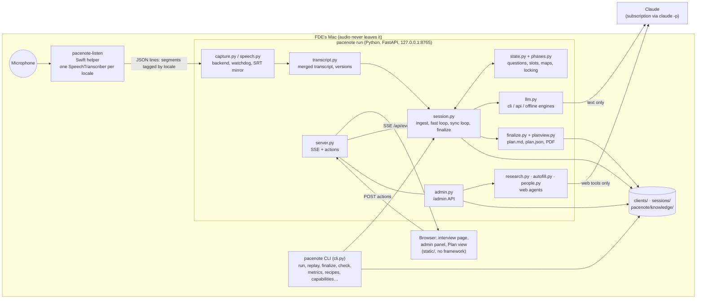
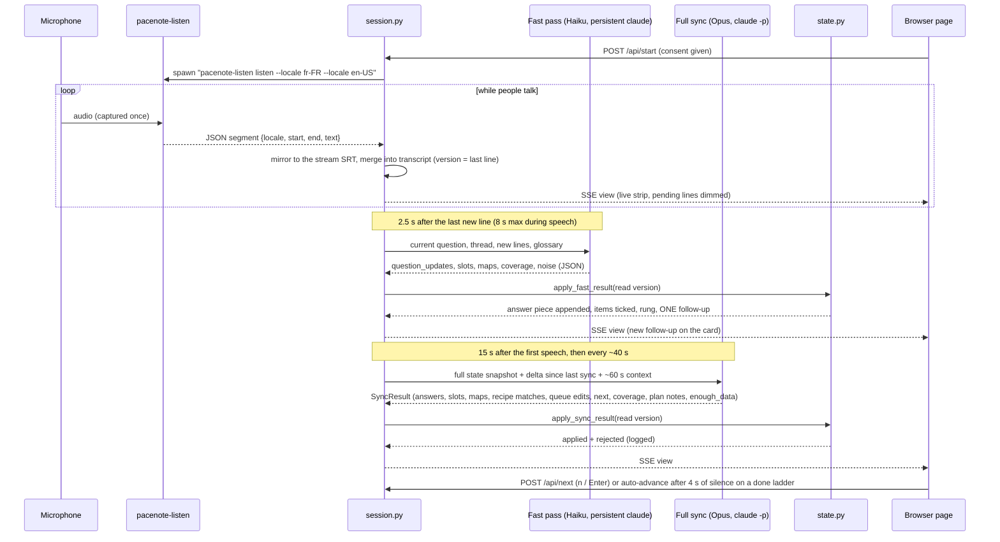
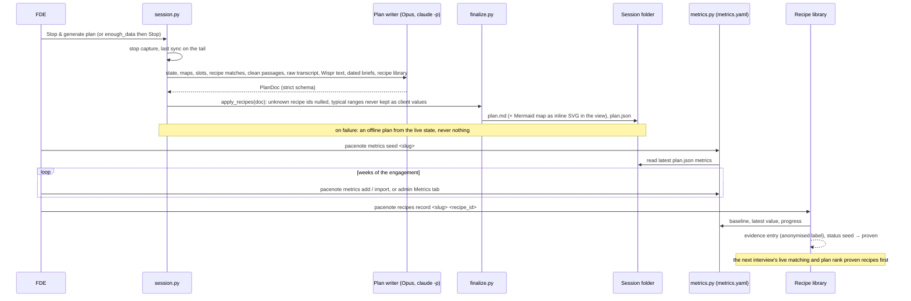

# Architecture

How Pacenote is built, for an engineer new to the code. The product side (why the interview
runs this way, what the plan is for) is in [prd.md](prd.md). Examples use the fictional example
client in `clients.example/brioche-four/`, a French distributor of bakery equipment.

## In one paragraph

`pacenote run` starts a local FastAPI server on the Mac. When the FDE clicks Start, the server spawns
one Swift helper (`pacenote-listen`) that captures the microphone once and transcribes it on-device in
every spoken language. Transcript lines are merged into one rolling transcript. Two model lanes
read it through the logged-in Claude Code CLI (`claude -p`): a **fast pass** (Haiku) a few seconds
after each answer, and a **full sync** (Opus) every 30–45 s. Both answer in a strict JSON contract;
`state.py` applies the results under locking and phase rules, and the browser page receives the
new view over Server-Sent Events. At the end, Opus writes a structured plan (`PlanDoc`), rendered
to `plan.md` + `plan.json`. The plan's metrics are monitored per client and the results flow back
into a tracked recipe library that the next interview starts from.

## Components



| Module | Role |
|---|---|
| `cli.py` | Entry point (`pacenote`, or `python -m pacenote`): `run`, `replay`, `finalize`, `purge`, `new-client`, `check`, `soak`, `next`, `admin`, `capabilities`, `metrics`, `recipes` |
| `server.py` | FastAPI app for one interview: `/` page, `/api/state`, `/api/events` (SSE), actions (`/api/start`, `/api/next`, `/api/next-phase`, `/api/sync`, `/api/questions/{id}/answered|skip`, `/api/enough`, `/api/wispr`, `/api/finalize`, `/api/language`), Plan view (`/plan`, `/api/plan`, `/api/plan/pdf`); mounts the admin router |
| `admin.py` | `/admin` page and `/admin/api/*`: clients, next client, research, pre-plan and history, Auto-fill, people cards, metrics, saved sessions and their plans |
| `web_guard.py` | Host allow-list and same-origin guard on every server |
| `listen/pacenote_listen.swift` | The speech helper: mic once, one `SpeechAnalyzer` + `SpeechTranscriber` per locale, JSON lines on stdout |
| `capture.py`, `speech.py` | Builds and caches the helper, the `TranscriptionBackend` interface (Apple helper, optional whisper.cpp), automatic fallback, watchdog, `ReplaySource` for SRT replays |
| `srt.py`, `transcript.py` | SRT parsing and tailing; the merged transcript of all streams, deltas, readable-stream selection |
| `session.py` | One interview: ingest loop, fast-pass loop, full-sync loop, focus moves, finalize, persistence, resume |
| `state.py` | `SessionState`: questions, thread, ladder, slots, maps, recipe matches, coverage, versions, every locking and phase rule |
| `phases.py` | The seven phases, their goals, maps and time budgets; assigns a phase to old-format questionnaires |
| `contract.py` | Pydantic models for the sync and fast-pass results, the maps and the `PlanDoc`; `SLOT_KEYS` |
| `prompts.py` | System and user prompts for the fast pass, the full sync and the plan; `QUESTION_STYLE` |
| `llm.py` | Engines: Claude Code CLI (default), Anthropic SDK, offline keyword heuristics; the persistent fast-pass process |
| `finalize.py` | `PlanDoc` → `plan.md` (with the Mermaid communication map rendered to inline SVG), `plan.json`, interview log, recipe rules (`apply_recipes`), Wispr import |
| `planview.py` | Plan view data, saved sessions list, PDF export through a headless Chrome-family browser |
| `questionnaire.py`, `clients.py` | Questionnaire schema and loader; client sheet, scaffold, next client, pre-plan merged into questionnaire and context, core questions merged in |
| `research.py`, `autofill.py`, `people.py` | Admin web agents: research + pre-plan (Opus), client-sheet Auto-fill (Sonnet), interviewee profile cards (Sonnet) with a privacy filter |
| `recipes.py`, `metrics.py`, `briefs.py` | Recipe library schema and evidence; per-client metrics with locking; the dated knowledge briefs and their refresh |
| `i18n.py`, `translate.py`, `locales/` | Catalogs shared with the browser, language resolution, on-the-fly translation through Claude |
| `static/` | Interview page (`index.html`, `app.js`), admin (`admin.*`), Plan view (`plan.*`), shared `i18n.js` |
| `core/questions.yaml` | The core questions of phases 1–4, merged into every client questionnaire |
| `knowledge/` | `capabilities.md`, `fde-practice.md` (dated briefs) and `recipes/<id>.yaml` (the recipe library) |

## Data on disk

```
clients/<slug>/                 one folder per client (git-ignored; clients.example/ holds the fictional one)
  questionnaire.yaml            seed questionnaire: use cases, themes, questions, ladders, slots, consent
  glossary.md                   known mishearings → correct terms, read by Claude
  client.yaml                   client sheet (admin form): company fields with provenance, contacts, notes
  research.md, preplan.md, preplan.json, history/<ts>/   admin research and pre-plan, previous versions
  people/<contact>.json         interviewee profile cards
  metrics.yaml                  metric definitions from the plan + dated measurements

sessions/<slug>/<YYYYMMDD-HHMMSS>/   one interview (git-ignored)
  fr.srt, en.srt …              each spoken language's segments, on the session clock (replayable)
  transcript.jsonl              merged transcript
  state.json, session.json      the full SessionState; the sync cursor
  sync_log.jsonl                every delta sent and every result, rejected edits, call durations, latencies
  capture.log, listen.log       listening events; the helper's stderr
  wispr.txt                     optional final Wispr Flow transcript
  plan.md, plan.json, plan.pdf  the integration proposal (PDF on demand)
sessions/<slug>/.translations/cache.json   translations reused by the next session in that language

pacenote/knowledge/          tracked: capabilities.md, fde-practice.md, recipes/<id>.yaml
~/.pacenote/config.json      the "next client" (PACENOTE_CONFIG)
~/Library/Caches/pacenote/   the compiled pacenote-listen, one file per source hash (PACENOTE_LISTEN_CACHE)
```

No audio file is ever written: the helper only outputs text. `pacenote purge` deletes session folders.
`clients/`, `sessions/` and any recording or transcript file are in `.gitignore`.

### Questionnaire

A client questionnaire declares `use_cases` (workflows an agent could take over: one plan section
each) and `themes` of questions. Each question has `fr`/`en` (or any language key), a `priority`
(1 must-have, 2 important, 3 if time allows), optional `use_case`, `slots`, an `expect` ladder
(1–3 concrete details per rung: business, workflow, implementation), `keywords` (offline engine
only) and a `phase`. The header of `clients.example/brioche-four/questionnaire.yaml` holds the
wording rules; `tests/test_questions.py` enforces the testable ones (no AI vocabulary, capacity
first, every question mapped to slots).

Loading a client (`clients.py`, `questionnaire.py`):

1. the client's `questionnaire.yaml` and `glossary.md`;
2. the core questions of phases 1–4 (`core/questions.yaml`), unless `core_questions: false`; a core
   question listing a client question in `replaces:` is dropped in favour of the client's wording;
3. with `use_preplan: true`, a theme « Pistes IA identifiées » of up to 4 pre-plan seed questions
   right after the first theme, and the pre-plan summary in the context as hypotheses to confirm;
4. the client sheet, notes and people cards appended to the context Claude receives.

### Integration slots

Every use case is drilled through the same nine slots (`SLOT_KEYS` in `contract.py`), the schema
the plan is written from:

| Slot | Holds | Rung |
|---|---|---|
| `baseline` | current cost: time spent, delays, errors | business |
| `target` | the success metric, with a number and a date | business |
| `trigger` | what starts the work and where it lives (mailbox, folder, portal, phone) | workflow |
| `actors` | who does it today, who acts on the result | workflow |
| `processing` | what is done with the data | workflow |
| `distribution` | who receives the result, channel, format | workflow |
| `tool` | the software by name, version, export or API | implementation |
| `access` | how an agent reaches it, credentials, who grants them | implementation |
| `volume` | how many per day or week, peaks | implementation |

A question on a use case shows its unfilled required slots as « Ce qui manque » and is answered
only once all of them hold what the CEO said (value + quote). A question without a use case keeps
its `expect` ladder (answered once at least half its items are heard) and sends its `slots` to the
model as `gathers_slots`, so the answer fills them on whichever use case the CEO describes.

## The live interview loop



### Capture

- `pacenote run` first runs `pacenote-listen prepare` (every locale's model reserved, installed and loaded,
  no microphone) and refuses to start with the real cause if that fails. The microphone opens only
  on Start, so small talk before consent is never transcribed.
- One process captures once and feeds one transcriber per locale: separate recognisers per
  language would each release and re-reserve Apple's speech assets and fail at random. The helper
  reserves every expected locale and never releases one, installs missing models (progress on the
  consent screen), loads them, opens the mic, then reports `ready`.
- Errors are JSON events with a code (`microphone`, `install_failed`, `unsupported_locale`…) shown
  once with the fix, never retried. A locale that cannot be made ready is skipped (`locale_failed`)
  and the interview continues in the others; only "no locale ready" refuses Start.
- The watchdog restarts a dead helper up to 5 times per outage (2, 4, 6, 6 s), shifting its
  segments to the session clock; a microphone-permission error is never restarted.
- `speech.py` selects the backend: `apple` (default on macOS 26+), optional `whisper`
  (whisper.cpp's `whisper-stream`, user-installed, never downloaded by the app), `auto` = Apple
  with whisper as a one-way fallback when the helper fails its health check (no language ready,
  watchdog gave up, or no audio heartbeat for `PACENOTE_HEARTBEAT_STALE` s).
- `ReplaySource` feeds saved SRT files instead (`pacenote replay`), at any speed.
- The other-language stream is gibberish while one language is spoken; `transcript.readable()`
  keeps, per moment, only the stream that reads correctly (function-word lists for fr, en, de, es,
  it, pt, nl).

### Two lanes, one call in flight each

| Lane | When | Model and process | Updates |
|---|---|---|---|
| Fast pass | 2.5 s after the last new line (`PACENOTE_FAST_DEBOUNCE`), 8 s at most | `claude-haiku-5-5`, one persistent `claude -p --input-format stream-json` process, recycled every 10 turns, fresh `claude -p` fallback | the current question's thread (answer piece, next single follow-up), items covered, rung, status; answers to other questions; coverage (upward only); noise lines (TV, nearby voices) |
| Full sync | 15 s after the first speech, then every `PACENOTE_SYNC_INTERVAL` (40 s) | `claude-opus-5-5`, one `claude -p --output-format json` per call, effort `low` | the whole contract below |

A tick that fires while the previous call runs is skipped (counted) and its lines go with the next
call. A failed round (network, refusal, invalid JSON) changes nothing; its delta is re-sent next
time. On a noisy replay at real speed, the end of a CEO answer reaches the screen as the next
follow-up in about 5–7 s (debounce + polling + a 1.5–3 s fast call).

### Versioned analyses (optimistic locking per record)

The transcript's version is its last line number. Every fast pass and full sync is stamped with
the version it read, and every question, slot, map record, recipe match and theme coverage keeps
the version of the analysis that last wrote it. A result only overwrites a record written by an
analysis that read no further than itself (equal versions apply). A slow full sync that read lines
1–40 and lands after a fast pass that read line 44 leaves that question's newer draft alone (logged
`stale`), while its queue edits, upcoming list and plan notes still apply. Rejecting whole results
instead would drop nearly every sync while people talk.

### Rules enforced in `state.py`

Whatever the model returns:

- The current question is never reworded, reordered or removed; a rewording proposed for it is
  appended to its thread as a follow-up. Focus moves only on `n` / Enter / `a` / `k`, `p` (next
  phase), or when the ladder is done and nobody spoke for 4 s.
- The thread alternates answer pieces and follow-ups; a pending follow-up is never swapped and
  never repeated. The rung only moves down the ladder and climbs once a rung is covered.
- Status only moves forward (`pending → partial → answered`); `answered` locks a question forever.
- Queue edits target `pending`/`partial` questions only, `remove` only `pending`; at most 3
  additions per sync; unknown ids and themes rejected; coverage clamped to 0–1.
- Queue edits and `next_questions` are accepted only for the current phase; an `add` with a new
  use case (a workflow mentioned early) is parked at the end of the deep dives.
- Answers, slots and map facts are captured whatever the phase; the focus never jumps.
- Every rejection is recorded (`edit_log` in `state.json`, `rejected` in `sync_log.jsonl`).

### Phases and maps

`phases.py` orders the interview in seven phases, an internal backbone the CEO never hears as a
form:

| # | Phase | About | Minutes (15-min interview) | Source |
|---|---|---|---|---|
| 0 | `wealth` | where the company makes and loses money, what limits growth | 1.5 | client questionnaire |
| 1 | `signal-carriers` | who reports to the CEO, who comes to him, for what | 1.5 | core questions |
| 2 | `signal-flow` | what passes between people, channels, who waits on whom; the two CEO patterns | 3 | core questions |
| 3 | `knowledge` | where the document was last time, who found it, unwritten rules | 2 | core questions |
| 4 | `decisions` | recurring decisions, context people arrive with, judgment vs repetitive glue | 2 | core questions |
| 5 | `deep-dives` | use-case walkthroughs through the nine slots | 4 | client questionnaire |
| 6 | `return` | ROI, budget, sign-off | 1 | client questionnaire |

Budgets scale with `target_minutes` (`phase_minutes:` overrides). A phase hands over at the next
focus change once its questions are done, its maps hold enough facts (`MAP_ENOUGH`, after at least
one of its questions was asked), or its budget is spent.

The maps (`maps` in the contract, `state.maps`) are filled from the CEO's stories: `org` (person,
role, department, reports to, time on judgment vs glue), `flows` (sender, receiver, what, channel,
cadence, wait, who waits, confidential, CEO pattern), `stores` (what, where, owner, how found, reuse
pain; know-how "in someone's head"), `decisions` (owner, frequency, inputs, prep vs decide time) and
the tool `catalog` (messaging, external channels incl. fax, portals and EDI, shared storage,
spreadsheets, core systems, task tracking, reporting). Each record has a stable id, merges field
by field with an evidence quote and carries its version.

### The sync contract

Each full sync returns exactly this JSON, enforced with `--json-schema` (CLI) or structured outputs
(API) and validated again with Pydantic (`contract.py`):

| Field | Content |
|---|---|
| `question_updates[]` | `question_id`, `status`, `answer` (merged summary), `answer_piece` (only what the new lines add), `evidence`, `covered`, `rung`, `follow_up` (the single next question), `vague` |
| `slots[]` | `use_case`, `slot`, `value` (everything known now, as said), `evidence` |
| `maps` | `org[]`, `flows[]`, `stores[]`, `decisions[]`, `catalog[]` records with stable ids and evidence |
| `recipe_matches[]` | `recipe_id`, `use_case`, `fit` (`strong`/`partial`/`none`), `heard_signals`, `missing` |
| `queue_edits[]` | `op` (`add`/`reword`/`reorder`/`remove`), `question_id`, `theme`, texts, `after_id`, `expect`, `use_case`, `use_case_title`, `reason` |
| `next_questions[]` | up to 3 open question ids after the current one |
| `coverage[]` | per theme: `score` 0–1 and a `note` |
| `plan_delta` | new bullets for `context`, `priorities`, `workflows`, `quick_wins`, `risks`, `budget`, `open_points` |
| `clean_passages[]` | cleaned, glossary-corrected transcript by speaker turn (feeds the interview log) |
| `enough_data`, `enough_data_reason` | switch to finalize mode (sticky) |

The fast pass returns `question_updates`, `slots`, `maps` (usually empty), `coverage` and `noise`;
its output is kept short because its latency grows with what it writes.

### Engines and `claude` processes

`llm.py` has three engines (`--engine`, `PACENOTE_ENGINE`):

- `cli` (default): the Claude Code CLI logged in with the Claude subscription. Each call runs in an
  empty temporary directory (no project `CLAUDE.md`), with `--tools ""`, `--strict-mcp-config`,
  `--no-session-persistence`, `CLAUDE_CODE_DISABLE_NONESSENTIAL_TRAFFIC=1`, and without
  `ANTHROPIC_API_KEY` / `ANTHROPIC_AUTH_TOKEN`, so it always uses the subscription login. Prompt on
  stdin, system prompt and JSON schema as arguments. Timeouts: 30 s fast pass, 120 s sync, 900 s plan.
- `api`: the Anthropic SDK (needs `ANTHROPIC_API_KEY`).
- `offline`: keyword matching on the questionnaire's `keywords`; deterministic, no network; used by
  tests and demos.

Every `claude` child is killed on shutdown; `pacenote-listen` runs in its own process group (SIGINT,
then SIGTERM, then SIGKILL).

### What leaves the Mac

Text only: instructions, client context and glossary, the question list with answers, the new
transcript lines plus ~60 s of context per sync, and at finalize the full transcript and the
optional Wispr text. `sync_log.jsonl` is the exact record. Audio never leaves; the Python app never
opens the microphone itself. `--offline` makes no network call.

### The interview screen

`static/index.html` + `app.js` render the view pushed over SSE with keyed in-place DOM updates, so
nothing jumps. One scrolling panel holds the thread: questions already asked (compact, with a
summary), then the current card, then the next questions. The current card reads in three levels:
the theme question as a calm header with its ladder (`Business 1/3 › Workflow 0/2 › Implémentation
0/2`) and inline controls; « À demander maintenant », the single follow-up to ask, the largest text
on screen; then the quiet details: « Ce qui manque » (items still missing on the current rung, or
the use case's unfilled slots), « Déjà capté », the live answer summary and the follow-ups already
asked. The upcoming list never reorders while someone talks (2.5 s of silence first). The side
panel shows time left, coverage, phases with time spent and map counts. The bottom strip shows the
readable stream only, without lines flagged as noise. The FDE console (`c`) holds languages, the
Wispr paste box, possible recipes, call durations and errors, and Stop & generate plan.

### Web safety

`web_guard.py` (on `run`, `replay` and `admin`) accepts only loopback names, the `--host` given and
`PACENOTE_ALLOWED_HOSTS`, which stops DNS rebinding; any state-changing request whose `Origin` or
`Sec-Fetch-Site` says cross-origin gets a 403. Research, pre-plan and plan Markdown render raw
HTML as text and neutralise `javascript:`/`data:` links (`finalize.md_to_html`); admin links are
clickable only when `http(s)` (`safeHref`). The server binds `127.0.0.1` by default and has no
authentication: `--host 0.0.0.0` only on a network you control.

## Finalize, plan, metrics and recipes



### The plan

`PlanDoc` (`contract.py`) is rendered by `finalize.render_plan_md` into `plan.md` and kept as
`plan.json`. It holds: context; current state (communication map, people, flows, tools, where
information lives, recurring decisions); bottlenecks (who waits on whom, incl. the two CEO
patterns); one metric per opportunity (name, unit, how measured, cadence, owner, baseline value and
date, target); opportunities typed `route_distil`, `act_on_behalf`, `status_without_asking`,
`decision_brief`, `capture_find_again`, `other`, each with the human decision kept, success statement and
check, first verified win on N real cases, what is not claimed, kill criterion, buy / configure /
build, adoption measure, impact and feasibility scores, architecture in one sentence, steps, model
provider and the nine slots; the recipe each reuses (`{id, fit, gaps}`) or a draft in
`recipe_candidates`; an engagement timeline (week 1 thin slice, week 4 checkpoint, week 8 go/kill);
open items to confirm with whom to ask; the interview log.

A slot is a fact only when it was said and quoted; otherwise it renders as « À confirmer » with the
question and the person to ask. A number nobody said is never estimated. Ranking is recipe-first
(strong fit on a proven recipe > strong on a seed > partial > new candidate), then back-office,
measurable, high-volume, then impact × feasibility.

The plan writer receives two dated briefs, `knowledge/capabilities.md` (what agents can do today;
the plan may not claim anything absent from it) and `knowledge/fde-practice.md` (how value is
proven). The plan footer states the brief's date; `pacenote check` and the Plan view warn past 30 days;
`pacenote capabilities refresh` rewrites them with a web-research run.

The Plan view (`/plan`, `/admin/plan/<slug>/<id>`) renders `plan.md` in the screen language's
chrome; **Export PDF** prints it with a headless Chrome-family browser already installed
(`PACENOTE_CHROME`), or falls back to the print dialog (HTTP 501).

### Recipes

A recipe (`knowledge/recipes/<id>.yaml`, strict schema in `recipes.py`, id = file name) holds:
`title`, `type` (same enum as opportunities), `status` (`seed` or `proven`), `flow` (trigger →
agent_does → writes_to / notifies → human_decision), `signals`, `preconditions`, `integrations`,
`probes` (story-form follow-ups, fr/en), `metrics` (with `typical_baseline` / `typical_target`,
never client facts), `proof` (first win, shadow mode, kills at weeks 4 and 8), `sourcing`, and
`evidence` (past engagements). Eight seeds ship with empty evidence.

- Live: the full sync gets the catalogue in compact form and returns `recipe_matches`, merged per
  (recipe, use case) with versions. Follow-ups may aim at a match's missing precondition or
  baseline, in story form, never naming the recipe. The FDE console lists possible recipes; the
  question card never does.
- Plan: matched recipes in full, the rest compact; recipe-backed metrics reuse the recipe's
  definition.
- Feedback: `pacenote recipes record` appends evidence from the client's `metrics.yaml` (label
  `client-<hash of slug>` unless `--client-name`) and flips the recipe to `proven`. Commit the file.

### Metrics

`clients/<slug>/metrics.yaml` holds the plan's metric definitions and dated measurements
(`pacenote metrics seed | show | add | import`, admin Metrics tab with inline SVG charts). Every write
takes an exclusive `fcntl` lock on a sibling `.metrics.yaml.lock`, re-reads the file, refuses the
write (`StaleWrite`, HTTP 409 in the admin) when its `version` is not the one the editor loaded,
bumps the version and writes atomically (`fsutil.atomic_write_text`).

## Admin panel and web agents

`pacenote admin` (port 8766) or `/admin` on a running interview server. All three agents are one
`claude -p` call each with `--tools WebSearch,WebFetch` only, no MCP, JSON schema output,
stream-json progress shown live, stoppable, no API key in the child environment.

| Agent | Model | Writes | Notes |
|---|---|---|---|
| Research + pre-plan (`research.py`) | Opus, effort high, 30 min timeout | `research.md`, `preplan.md`, `preplan.json`; previous run in `history/` | use cases scored on value × feasibility, seed questions with ladders; a failed or stopped run changes nothing |
| Auto-fill (`autofill.py`) | Sonnet, effort medium | `client.yaml` fields with per-field provenance | registered company first, distributed brands as linked entities; unsourced or < 0.3 confidence dropped; source pages checked (private addresses never opened); manual values never overwritten; candidates listed when the name is ambiguous; same request reused for 30 min |
| People (`people.py`) | Sonnet | `people/<contact>.json` | professional, publicly self-published facts only; `privacy_filter` drops family, health, religion, politics, orientation, origin, finances, legal, birth dates, addresses, contact details; homonyms listed for a pick |

The « next client » (`~/.pacenote/config.json`, `pacenote next`) is the default for `run`, `replay`,
`finalize`, `check` and `soak`.

## Languages

Three independent languages per session:

| | What | Default |
|---|---|---|
| Display | everything on the FDE screen, one language at a time | the client's interview language when it has a locale file, else English |
| Interview | what Claude generates: follow-ups, summaries, plan | the questionnaire's `language` |
| Spoken | the speech locales listening | questionnaire `speech_locales`, else `fr-FR` + `en-US` |

`locales/<lang>.json` (i18next format) is read by Python (`i18n.py`) and the browser (`i18n.js`);
adding a language is adding a file. Questionnaire texts missing in the interview language are
translated by Claude (`translate.py`, fast model, parallel calls, cached per client). Display
switching is instant and stored in the session state, so a reload or a second screen gets the
same view.

## Configuration

| Variable | Default | Meaning |
|---|---|---|
| `PACENOTE_ENGINE` | `cli` | `cli` · `api` · `offline` |
| `PACENOTE_CLAUDE_BIN` | `claude` on PATH | Claude Code CLI; falls back to `~/.claude/local/claude`, `~/.local/bin`, Homebrew |
| `PACENOTE_MODEL` | `claude-opus-5-5` | full syncs and the plan |
| `PACENOTE_FAST_MODEL` | `claude-haiku-5-5` | fast pass (`--no-fast` disables it) |
| `PACENOTE_SYNC_EFFORT` / `PACENOTE_PLAN_EFFORT` | `low` / `high` | effort of syncs / plan |
| `PACENOTE_SYNC_INTERVAL` / `PACENOTE_FIRST_SYNC_DELAY` | `40` / `15` | seconds between full syncs / first sync after first speech |
| `PACENOTE_FAST_DEBOUNCE` | `2.5` | seconds after the last new line before a fast pass |
| `PACENOTE_LISTEN_BIN` / `PACENOTE_LISTEN_CACHE` | built / `~/Library/Caches/pacenote` | prebuilt helper / build cache |
| `PACENOTE_SPEECH_BACKEND` | `auto` | `auto` · `apple` · `whisper` |
| `PACENOTE_WHISPER_BIN` / `PACENOTE_WHISPER_MODEL` | `whisper-stream` / unset | optional whisper.cpp backend |
| `PACENOTE_HEARTBEAT_STALE` | `10` | seconds without audio before the helper counts as unhealthy |
| `PACENOTE_LISTEN_RESTARTS` / `PACENOTE_LISTEN_RESTART_GAP` | `5` / `2` | watchdog budget and pause base |
| `PACENOTE_LOCALES` | questionnaire, else `fr-FR,en-US` | spoken languages, primary first |
| `PACENOTE_INTERVIEW_LANGUAGE` / `PACENOTE_UI_LANGUAGE` | questionnaire / client language | interview / display language |
| `PACENOTE_CLIENTS_DIR` / `PACENOTE_SESSIONS_DIR` | `clients` / `sessions` | data roots |
| `PACENOTE_CONFIG` | `~/.pacenote/config.json` | where the next client is stored |
| `PACENOTE_RESEARCH_MODEL` / `PACENOTE_AUTOFILL_MODEL` / `PACENOTE_PEOPLE_MODEL` | Opus / Sonnet / Sonnet | admin agents |
| `PACENOTE_ENGINEER_CONTEXT` | unset | the engineer's own company, one line (e.g. "Acme Labs, a software consultancy"); profile cards then look for what a person has in common with it; unset, they skip that category |
| `PACENOTE_HOST` / `PACENOTE_PORT` / `PACENOTE_ADMIN_PORT` | `127.0.0.1` / `8765` / `8766` | bind address and ports |
| `PACENOTE_ALLOWED_HOSTS` | none | extra host names accepted (e.g. a LAN name for an iPad) |
| `PACENOTE_CHROME` | first Chrome-family browser found | PDF export browser; empty = print dialog |

## Platform

The live mode needs macOS 26 or later (`SpeechAnalyzer`, `SpeechTranscriber`, `AssetInventory`)
and the Xcode Command Line Tools (`swiftc` builds the helper once, cached by source hash). macOS
grants the microphone to the terminal app that launched `pacenote`; a launchd job or an SSH session
cannot get it. Replay, the tests and the web UI run anywhere Python 3.12+ runs. The whisper backend
is platform-aware but the rest of the app (process groups, PDF export) assumes macOS or Linux.

## Tests

`pytest` runs the suite (unit and integration, no network). Replays use synthetic SRTs written at
test time from `tests/srt_samples.py`; questionnaires come from frozen fixtures
(`tests/fixtures/clients/brioche-four` for engine mechanics, `brioche-four-slots` for use cases and
slots) so the example client can evolve. Stand-in `claude` and `pacenote-listen` scripts speak the real
protocols. Real-browser tests need Node and the `playwright` package (`NODE_PATH=…`) and are
skipped without them; the PDF test needs a Chrome-family browser.
