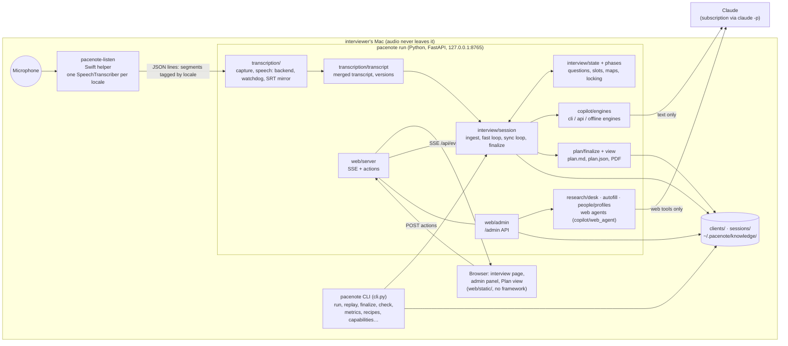
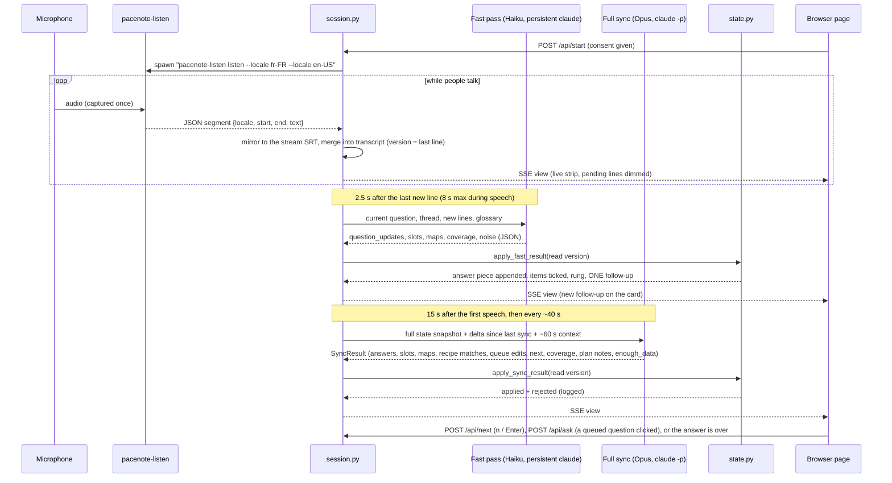
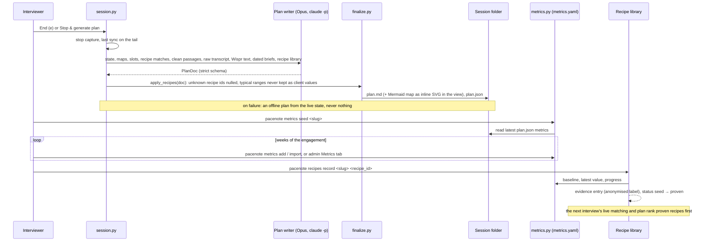

# Architecture

How Pacenote is built, for an engineer new to the code. What it does and how to set it up is in
the [README](../README.md). Examples use the fictional example
client in `clients.example/brioche-four/`, a French distributor of bakery equipment.

## In one paragraph

`pacenote run` starts a local FastAPI server on the Mac. When the interviewer clicks Start, the server spawns
one Swift helper (`pacenote-listen`) that captures the microphone once and transcribes it on-device in
every spoken language. Transcript lines are merged into one rolling transcript. Two model lanes
read it through the logged-in Claude Code CLI (`claude -p`): a **fast pass** (Haiku) a few seconds
after each answer, and a **full sync** (Opus) every 30–45 s. Both answer in a strict JSON contract;
`interview/state.py` applies the results under locking and phase rules, and the browser page receives the
new view over Server-Sent Events. At the end, Opus writes a structured plan (`PlanDoc`), rendered
to `plan.md` + `plan.json`. The plan's metrics are monitored per client and the results flow back
into a tracked recipe library that the next interview starts from.

## Components



The package has one sub-package per bounded context. Each context owns its rules and its data files;
dependencies point from the interface (`cli.py`, `web/`) to the application services (`interview/session.py`, the
research managers) to the domain modules, and the model calls stay behind `copilot/`.

```
pacenote/
  cli.py          command line (interface)
  web/            FastAPI apps, same-origin guard, static pages (interface)
  interview/      the interview: questionnaire, phases, state and its rules, the session that runs them
  copilot/        the model side: JSON contract, prompts, engines, the Claude web agent
  people/         who is in the meeting: personas, attendees, potential pilots, sponsor, views heard, profile cards
  research/       before the interview: desk research and pre-plan, auto-fill, horizons and the pace
  clients/        client folders and the client sheet
  plan/           after the interview: the plan, its headings, the Plan view and PDF, metrics
  knowledge/      the dated briefs and the recipe library (shipped in data/, local overlay)
  transcription/  speech helper, backends, SRT, merged transcript
  shared/         atomic writes, languages
```

| Module | Role |
|---|---|
| `cli.py` | Entry point (`pacenote`, or `python -m pacenote`): `run`, `replay`, `finalize`, `purge`, `new-client`, `check`, `soak`, `next`, `admin`, `capabilities`, `metrics`, `recipes` |
| `web/server.py` | FastAPI app for one interview: `/` page, `/api/state`, `/api/events` (SSE), actions (`/api/start`, `/api/next`, `/api/next-phase`, `/api/extend`, `/api/sync`, `/api/questions/{id}/answered|skip`, `/api/enough`, `/api/wispr`, `/api/finalize`, `/api/language`), Plan view (`/plan`, `/api/plan`, `/api/plan/pdf`); mounts the admin router |
| `web/admin.py` | `/admin` page and `/admin/api/*`: clients, next client, research, pre-plan and history, Auto-fill, people cards, metrics, saved sessions and their plans |
| `web/common.py` | What both apps share: `STATIC_DIR`, the i18n catalog routes, the Plan view responses |
| `web/guard.py` | Host allow-list and same-origin guard on every server |
| `web/static/` | Interview page (`index.html`, `app.js`), admin (`admin.*`), Plan view (`plan.*`), shared `i18n.js` |
| `interview/session.py` | One interview: ingest loop, fast-pass loop, full-sync loop, focus moves, finalize, persistence, resume |
| `interview/state.py` | `SessionState`: questions, thread, ladder, slots, maps, recipe matches, coverage, versions, every locking and phase rule |
| `interview/phases.py` | The seven phases, their goals, maps and time budgets; assigns a phase to old-format questionnaires |
| `interview/timebox.py` | The time budget: each step's share of the time left, each question's slot, the protected closing |
| `interview/coverage.py` | Coverage first: the areas of the company (`interview/core/areas.yaml` or the questionnaire's `areas:`), the time on each from the model's topic labels, drift on the conversation's point, the move-on with its transition line, `x` to keep going |
| `interview/questionnaire.py`, `interview/preparation.py` | Questionnaire schema and loader; what an interview starts from for a client: core questions (`interview/core/questions.yaml`), the pre-plan's seed questions, the pace's questions, the model's background (`load_client`) |
| `interview/lens.py` | The executive lens: talking points on manual work and metric questions per workflow (merge, wording guard, timing, template fallback for metric questions); what the plan may use of them |
| `interview/translate.py` | On-the-fly translation of the questionnaire into the interview language through Claude, cached per client |
| `copilot/contract.py` | Pydantic models for the sync and fast-pass results, the maps and the `PlanDoc`; `SLOT_KEYS` |
| `copilot/prompts.py` | System and user prompts for the fast pass, the full sync and the plan; `QUESTION_STYLE` |
| `copilot/engines.py` | Engines: Claude Code CLI (default), Anthropic SDK, offline keyword heuristics; the persistent fast-pass process |
| `copilot/web_agent.py` | The Claude web agent shared by the admin agents and the brief refresh: one `claude -p` run with web search and fetch only, streamed as progress steps (`AgentJob`, `run_claude_stream`) |
| `people/personas.py` | Who is interviewed: the persona (executive, function leader, operator) inferred from title, headcount and notes, refined by the research, overridden by hand; questions re-worded and re-weighed per persona (`personas:` in the questions YAML); what the interviewee can't answer recorded as "to check with" (defers those details on the card, listed in the plan) |
| `people/attendees.py` | Who is in the meeting: every person on the client sheet with a persona, the lead (whose persona sets the questions), who to address a question to (the model's pick, else the rung); console view and prompt blocks |
| `people/pilots.py` | Potential pilots: use case → person links; the interviewee read and the indirect people questions per workflow (merge, wording guard, timing, tone from the pace, template fallback); the sponsor question (what the leader in the meeting would do themself); the pilots the plan names, people or groups; the local `ambassadors.json` (engine fills, hand edit wins) |
| `people/sponsor.py` | The sponsor of the first wave: always the leader in the meeting (an executive, else a function leader), alongside any pilots; none with operators only (to confirm with the leadership). No expected count: pilots come only from the interview |
| `people/viewpoints.py` | The views heard on AI, grouped by statement, not by person (keen, open, cautious, opposed, practical; position, topic, verbatim quotes; a speaker only when the quote itself names them); console view, sync snapshot, the plan's points to address; after the meeting, quotes mapped to the voices of a final transcript with speaker labels (`refine`), else speakers unavailable |
| `research/desk.py`, `research/autofill.py`, `people/profiles.py` | Admin web agents: research + pre-plan + sector pre-study (Opus), client-sheet Auto-fill (Sonnet), interviewee profile cards (Sonnet) with a privacy filter |
| `research/horizons.py` | Horizon tags (h1 execution now, h2 emerging, h3 foresight), the pre-study's 0–10 score and posture (explorer / pragmatic / urgent, operator-only), the posture's questions (`core/horizons.yaml`) (`research/horizons.yaml`); the pre-study view the admin shows |
| `clients/sheet.py` | Client folders: the client sheet, scaffold, next client, the pre-plan on disk |
| `plan/finalize.py`, `plan/headings.py` | `PlanDoc` → `plan.md` (with the Mermaid communication map rendered to inline SVG), `plan.json`, interview log, recipe rules (`apply_recipes`), Wispr import; the plan's headings in the interview language |
| `plan/view.py` | Plan view data, saved sessions list, PDF export through a headless Chrome-family browser |
| `plan/metrics.py` | Per-client metrics (`metrics.yaml`) with locking, seeded from the plan |
| `knowledge/briefs.py`, `knowledge/refresh.py`, `knowledge/recipes.py` | The dated knowledge briefs, their refresh, the recipe library and its evidence. Shipped in `knowledge/data/`; what a machine writes goes to the local knowledge folder, which wins over the shipped file |
| `transcription/listen/pacenote_listen.swift` | The speech helper: mic once, one `SpeechAnalyzer` + `SpeechTranscriber` per locale, JSON lines on stdout |
| `transcription/capture.py`, `transcription/speech.py` | Builds and caches the helper, the `TranscriptionBackend` interface (Apple helper, optional whisper.cpp), automatic fallback, watchdog, `ReplaySource` for SRT replays |
| `transcription/srt.py`, `transcription/transcript.py` | SRT parsing and formatting; the merged transcript of all streams, deltas, readable-stream selection |
| `shared/i18n.py`, `shared/locales/`, `shared/fsutil.py` | Catalogs shared with the browser, language resolution; atomic file writes |

## Data on disk

```
clients/<slug>/                 one folder per client (git-ignored; clients.example/ holds the fictional one)
  questionnaire.yaml            seed questionnaire: use cases, themes, questions, ladders, slots, consent
  glossary.md                   known mishearings → correct terms, read by Claude
  client.yaml                   client sheet (admin form): company fields with provenance, contacts (name, role, notes, persona), notes
  research.md, preplan.md, preplan.json, history/<ts>/   admin research and pre-plan, previous versions
  people/<contact>.json         interviewee profile cards
  ambassadors.json              potential pilots (person or role, use case, the interviewee's quote); git-ignored everywhere
  metrics.yaml                  metric definitions from the plan + dated measurements

sessions/<slug>/<YYYYMMDD-HHMMSS>/   one interview (git-ignored)
  fr.srt, en.srt …              each spoken language's segments, on the session clock (replayable)
  transcript.jsonl              merged transcript
  state.json, session.json      the full SessionState; the sync cursor
  sync_log.jsonl                every delta sent and every result, rejected edits, call durations, latencies
  capture.log, listen.log       listening events; the helper's stderr
  wispr.txt                     optional final Wispr Flow transcript
  plan.md, plan.json, plan.pdf  the integration proposal (PDF on demand)
sessions/<slug>/.translations/cache.json   translations reused by the next session in that language

pacenote/knowledge/data/     tracked: capabilities.md, delivery-practice.md, recipes/<id>.yaml (shipped)
~/.pacenote/knowledge/       refreshed briefs and recipes with recorded evidence (PACENOTE_KNOWLEDGE_DIR); wins over data/
~/.pacenote/config.json      the "next client" (PACENOTE_CONFIG)
~/Library/Caches/pacenote/   the compiled pacenote-listen, one file per source hash (PACENOTE_LISTEN_CACHE)
```

No audio file is ever written: the helper only outputs text. `pacenote purge` deletes session folders.
`clients/`, `sessions/` and any recording or transcript file are in `.gitignore`.

### Questionnaire

A client questionnaire declares `use_cases` (workflows an agent could take over: one plan section
each) and `themes` of questions. Each question has `fr`/`en` (or any language key), a `priority`
(1 must-have, 2 important, 3 if time allows), optional `use_case`, `slots`, an `expect` ladder
(1–3 concrete details per rung: business, workflow, implementation), `keywords` (offline engine
only) and a `phase`. The header of `clients.example/brioche-four/questionnaire.yaml` holds the
wording rules; `tests/interview/test_questions.py` enforces the testable ones (no AI vocabulary, capacity
first, every question mapped to slots).

Loading a client (`interview/preparation.py`):

1. the client's `questionnaire.yaml` and `glossary.md`;
2. the core questions of phases 1–4 (`interview/core/questions.yaml`), unless `core_questions: false`; a core
   question listing a client question in `replaces:` is dropped in favour of the client's wording;
3. with `use_preplan: true`, a theme « Pistes IA identifiées » of up to 4 pre-plan seed questions
   right after the first theme, and the pre-plan summary in the context as hypotheses to confirm;
4. the client sheet, notes and people cards appended to the context Claude receives.

### Integration slots

Every use case is drilled through the same nine slots (`SLOT_KEYS` in `contract.py`), the schema
the plan is written from:

| Slot | Holds | Rung |
|---|---|---|
| `baseline` | current cost: time spent, delays, errors | business |
| `target` | the success metric, with a number and a date | business |
| `trigger` | what starts the work and where it lives (mailbox, folder, portal, phone) | workflow |
| `actors` | who does it today, who acts on the result | workflow |
| `processing` | what is done with the data | workflow |
| `distribution` | who receives the result, channel, format | workflow |
| `tool` | the software by name, version, export or API | implementation |
| `access` | how an agent reaches it, credentials, who grants them | implementation |
| `volume` | how many per day or week, peaks | implementation |

A question on a use case shows its unfilled required slots as « Ce qui manque » and is answered
only once all of them hold what the interviewee said (value + quote), or were deferred to someone else ("to check with"). A question without a use case keeps
its `expect` ladder (answered once at least half its items are heard) and sends its `slots` to the
model as `gathers_slots`, so the answer fills them on whichever use case the interviewee describes.

## The live interview loop



### Capture

- `pacenote run` first runs `pacenote-listen prepare` (every locale's model reserved, installed and loaded,
  no microphone) and refuses to start with the real cause if that fails. The microphone opens only
  on Start, so small talk before consent is never transcribed.
- **Listening belongs to the interview** (`interview/lifecycle.py`). It stops the moment the interview
  ends: End / `e` / `/api/enough` / `/api/finalize`, the time is up (the planned length), no interview
  screen open for 10 s (the page's `/api/events` stream; a reload comes back well within that), nobody
  heard for 5 minutes, or the server stops. `Session._set_mode` is the only writer of `state.mode`:
  leaving "interview" stops capture before the last analysis and the plan run, and only `Session.start`
  enters it, from consent. `persist()` re-checks the rule on every save. Outside the interview nothing
  reads the recogniser and the watchdog never restarts one; a live recogniser refuses `--auto-start`.
  A replay stops hearing when stopped too: its last flush is what was said by then, never the rest of
  the recording. The screen's listening mark follows `listening.on` (the recogniser open), not the mode.
- One process captures once and feeds one transcriber per locale: separate recognisers per
  language would each release and re-reserve Apple's speech assets and fail at random. The helper
  reserves every expected locale and never releases one, installs missing models (progress on the
  consent screen), loads them, opens the mic, then reports `ready`.
- Errors are JSON events with a code (`microphone`, `install_failed`, `unsupported_locale`…) shown
  once with the fix, never retried. A locale that cannot be made ready is skipped (`locale_failed`)
  and the interview continues in the others; only "no locale ready" refuses Start.
- The watchdog restarts a dead helper up to 5 times per outage (2, 4, 6, 6 s), shifting its
  segments to the session clock; a microphone-permission error is never restarted.
- `transcription/speech.py` selects the backend: `apple` (default on macOS 26+), optional `whisper`
  (whisper.cpp's `whisper-stream`, user-installed, never downloaded by the app), `auto` = Apple
  with whisper as a one-way fallback when the helper fails its health check (no language ready,
  watchdog gave up, or no audio heartbeat for `PACENOTE_HEARTBEAT_STALE` s).
- `ReplaySource` feeds saved SRT files instead (`pacenote replay`), at any speed.
- The other-language stream is gibberish while one language is spoken; `transcript.readable()`
  keeps, per moment, only the stream that reads correctly (function-word lists for fr, en, de, es,
  it, pt, nl).

### Two lanes, one call in flight each

| Lane | When | Model and process | Updates |
|---|---|---|---|
| Fast pass | 2.5 s after the last new line (`PACENOTE_FAST_DEBOUNCE`), 8 s at most | `claude-haiku-5-5`, one persistent `claude -p --input-format stream-json` process, recycled every 10 turns, fresh `claude -p` fallback | the current question's thread (answer piece; the next follow-up, queued under what is being asked), items covered, rung, status; answers to other questions; coverage (upward only); noise lines (TV, nearby voices) |
| Full sync | 15 s after the first speech, then every `PACENOTE_SYNC_INTERVAL` (40 s) | `claude-opus-5-5`, one `claude -p --output-format json` per call, effort `low` | the whole contract below |

A tick that fires while the previous call runs is skipped (counted) and its lines go with the next
call. A failed round (network, refusal, invalid JSON) changes nothing; its delta is re-sent next
time. On a noisy replay at real speed, the end of a CEO answer reaches the screen as the next
follow-up, queued under the question being answered, in about 5–7 s (debounce + polling + a 1.5–3 s
fast call). Live, Apple's recogniser delivers its final results in batches about every 11.5 s, which
adds up to that much before the words even reach the fast pass.

### What is asked now (answer pacing)

Nobody can tell when someone has finished: they may go on 5 or 10 s later. So the question being
answered (`ask_pin`: the follow-up asked, else the focus question) never changes because a model
result arrived. A new follow-up is queued under it (`ask_next`, at most 2; on a full queue the newest replaces
the oldest, the latest answer being the best guide), and once the focus question is answered, or its
time slot is over (below), the next question is queued after them (`ask_next_qid`). Queued follow-ups are not in the thread, since the thread and the prompts hold
what was asked; the prompts get them as `queued` so they are never proposed twice. The pinned item
retires only on an "answer over" signal (`Session._answer_over`, checked every poll):

| Signal | How it is read | Then |
|---|---|---|
| The interviewer reads a queued question | A line that starts a turn (≥ 0.6 s gap on the speech clock, not the first lines after the pin; for a follow-up, said after it appeared) holds ≥ 60 % of the question's content words, and they make up ≥ ⅓ of the words heard; the turn's first lines up to its next gap (a long question comes as several ~60-character lines) | That item is asked now, at once (earlier queued ones are dropped) |
| The question is complete | An analysis (fast pass or full sync) turns the focus question from open to answered: the model's call (the ladder done), accepted only past the existing gate, every slot item plus half of the other expected details (`QuestionState.sufficient`); from an answer given after what is asked now went up (a turn starts after it in the lines it read; a pending completion is dropped when the interviewer reads or clicks a follow-up) | The focus moves to the next question at once, even while the interviewee goes on |
| The interviewee answers the next question | The fast pass gives the queued next question an answer piece and none to the current one | The focus moves there |
| The question's time slot is over | `timebox.slot_over` (below), something said since the pin, then the first boundary: a sure pause of 1.5 s; once the slot is 30 s over, a new line ending in . ? ! | The next question moves up, before any queued follow-up |
| The conversation stayed on one point | `coverage.pending_qid` (below): the next area's question is queued, on screen at least 10 s (whatever the slot on screen says); then a sure pause of 1.5 s, or once it has been queued 30 s, a new line ending in . ? ! | The next area's question moves up, unless the interviewer keeps going (`x`) |
| A real pause after the answer | Something was said since the pin; the fast pass read every line; then a pause on the speech clock of 3.5 s after a line ending in . ? ! (7 s after any other line: the recogniser cuts long sentences into ~60-character lines) | The first queued item moves up (the next question if the focus is answered) |
| The interviewer | `n` / Enter, `a`, `k`, `p`, or a click on a queued question | As before (`n` and `a` go to the « Question suivante » shown); a click asks that item |

Completion moves at most once per stretch of speech. After it, what the interviewee still says is the
tail of the old answer, not the answer to the new question: the tail ends when the interviewer asks the
new question (a turn holding 4 of its content words, half of the turn's: a paraphrase of a long question;
its answer counts from the end of that turn),
at a gap in the line timestamps as long as the pause above (exact even when lines arrive in batches), or
on a sure pause. Until then nothing moves: a question completed by the tail, or a follow-up drawn from it,
waits; the answer to the new question counts from the end of the tail.

The pause is counted on the speech clock (segment `end`), beyond how long speech can stay unseen: a
line arrives only once it ends, so the delay is the longest, over the recent lines, of speech clock at
arrival − line start, plus 25 % (live batches sometimes skip a period). Live, Apple's final results come
in batches about every 11.5 s (often 23 s): in the first real interview that margin was ~36 s, a
pause-based move was possible ~1 % of the time, and a live conversation rarely pauses long anyway (10
pauses of 3.5 s after a sentence end in 47 minutes). That is why time, not a pause, moves the interview
on (below). A real-time speech signal was tried and left out: the recogniser's volatile results come in
the same 11.5 s batches; with `fastResults` they follow the voice (~1 s) but the final lines lose about a
quarter of their words; Apple's `SpeechDetector` gave no result. `timing.jsonl` in the session folder logs
the clock, the last line's end, the microphone level, the pause and the slot every 2 s, to calibrate one
on real audio. `pacenote-listen listen --file X --realtime` feeds a file at its own pace to check live
timing without the microphone. A replay with `--batch 11.5` delivers the lines like live; `--transcript`
replays a recorded session with its own delivery. The same measure freezes the upcoming list. Every change is logged
(`kind: ask` / `focus` in `sync_log.jsonl`, with its reason).

### Versioned analyses (optimistic locking per record)

The transcript's version is its last line number. Every fast pass and full sync is stamped with
the version it read, and every question, slot, map record, recipe match and theme coverage keeps
the version of the analysis that last wrote it. A result only overwrites a record written by an
analysis that read no further than itself (equal versions apply). A slow full sync that read lines
1–40 and lands after a fast pass that read line 44 leaves that question's newer draft alone (logged
`stale`), while its queue edits, upcoming list and plan notes still apply. Rejecting whole results
instead would drop nearly every sync while people talk.

### Rules enforced in `state.py`

Whatever the model returns:

- The current question is never reworded, reordered or removed; a rewording proposed for it is
  queued under it as a follow-up. Focus moves only on `n` / Enter / `a` / `k`, `p` (next phase), a
  click on the queued next question, or once the answer is over (see "What is asked now").
- What is being answered is never swapped by a model result: follow-ups queue under it (at most 2),
  never repeated, and join the thread when asked. The rung only moves down the ladder and climbs once
  a rung is covered.
- Status only moves forward (`pending → partial → answered`); `answered` locks a question forever.
- Queue edits target `pending`/`partial` questions only, `remove` only `pending`; at most 3
  additions per sync; unknown ids and themes rejected; coverage clamped to 0–1.
- Queue edits and `next_questions` are accepted only for the current phase; an `add` with a new
  use case (a workflow mentioned early) is parked at the end of the deep dives.
- Answers, slots and map facts are captured whatever the phase; the focus never jumps.
- Every rejection is recorded (`edit_log` in `state.json`, `rejected` in `sync_log.jsonl`).

### Phases and maps

`phases.py` orders the interview in seven phases, an internal backbone the interviewee never hears as a
form:

| # | Phase | About | Minutes (15-min interview) | Source |
|---|---|---|---|---|
| 0 | `wealth` | where the company makes and loses money, what limits growth | 1.5 | client questionnaire |
| 1 | `signal-carriers` | who reports to the CEO, who comes to him, for what | 1.5 | core questions |
| 2 | `signal-flow` | what passes between people, channels, who waits on whom; the two CEO patterns | 3 | core questions |
| 3 | `knowledge` | where the document was last time, who found it, unwritten rules | 2 | core questions |
| 4 | `decisions` | recurring decisions, context people arrive with, judgment vs repetitive glue | 2 | core questions |
| 5 | `deep-dives` | use-case walkthroughs through the nine slots | 4 | client questionnaire |
| 6 | `return` | ROI, budget, sign-off | 1 | client questionnaire |

Budgets scale with `target_minutes` (20 by default; `pacenote run --minutes`; `phase_minutes:` overrides
the weights). A phase hands over at the next focus change once its questions are done, its maps hold
enough facts (`MAP_ENOUGH`, after at least one of its questions was asked), or its budget is spent.

### The time budget (`interview/timebox.py`)

Time moves the interview on, on the interview's clock (`SessionState.now()`: Start + the speech clock,
so a replay at any speed keeps the pace):

- **Each step gets its share of the time left** when it starts: the time left minus the closing step's
  reserve, split across the steps still to come by their planned minutes. A short step gives its time to
  the next ones; a long one takes it from them, never from the closing.
- **Each question gets a slot**: its share of what is left of its step, priority 1 counting double, at
  least 60 s. Once the slot is over, no follow-up is queued on it (the prompts get `time_over`) and the
  next question is queued under the one being answered; it moves up at the first boundary (table above),
  never on a line cut mid-sentence (live, the sentence end is seen in the next batch, 10–20 s after it was
  said). Once nothing new can be queued (every question asked), follow-ups come back. A step with less than a slot left starts only a priority-1 question: an overrun eats
  the priority 2 and 3 questions first.
- **The closing is protected**: its reserve is its planned time, and at least a slot plus its grace
  (60 + 30 s) per closing question still open, because the time being up ends the interview; its slots
  are computed net of those graces. When the time left reaches that reserve, the question on
  screen gives way at its next boundary (no grace) and the closing's questions come next, wherever the
  interview is; past the time (only with a `lifecycle.OVERRUN`) they still go first, then the questions
  left over, priority 1 first. Time
  only moves to a question not asked yet: once every question went up, the one on screen stays until the
  interviewer moves on or ends.

The screen shows the time left out of the planned length (past it, the time beyond it, quietly).
When the model says the essentials are covered (`enough_data`) nothing stops: listening, the analyses
and the questions go on, and the End button (`e`) lights up for the interviewer. When the time is up
(`lifecycle.OVERRUN` after the planned length, 0 by default) the interview ends: listening stops at once,
the plan is written and opens in the Plan view, as when the interviewer ends it (`e`, the console, or
`/api/enough`). See Capture for every other way it ends.

### Coverage first (`interview/coverage.py`)

The interview goes around the whole company before it goes deep: in the first real interview one case
took the whole hour while the question on screen kept changing. The model labels, the code decides:

- **The areas** (`interview/core/areas.yaml`: sales, customer service, after-sales, purchasing, logistics,
  marketing, finance, people, IT; a questionnaire's `areas:` narrows or reorders them, or adds its own),
  each with a title, a short label and one ready question.
- **The label**: each full sync returns `topic` for the slice it read: the main area (an id, or `other`),
  the specific point, `same_point`, `repeating`, and the areas `discussed` (a concrete exchange) or only
  `mentioned`. Results recorded before the field load with `topic: null`.
- **Coverage**: the time from one label to the next goes to the area the label names (at most 120 s per
  label). An area is *covered* after 60 s as the point, *touched* once discussed or mentioned. The side
  panel shows a dot per area (empty, half, full) and underlines the current point's area; the plan lists the
  untouched areas as open items.
- **Drift is measured on the conversation**: the current point starts when a label names another area (and
  not the same point); question changes on screen, `other`, an unknown id or a failed sync never reset it,
  so a missing analysis never silences the move-on (before any area was named, a slice labelled `other` moves
  the first point's start to its end; with no label at all it runs from the interview's start). Allowance: the interview length over the number of
  areas, between 2 and 5 minutes (133 s for 20 minutes and 9 areas: every area fits in the planned length); × 2 once no area is left
  untouched; × 0.6 after two slices in a row that only repeat the point; + 3 minutes per `x`.
- **The move-on**: once the point has had its allowance, the first untouched area (then touched but not
  covered, then once more an area whose question went up but that is still untouched: shown is not covered;
  never one already suggested on this point) gets its question, in the current step, through the
  queued-next slot: the screen shows a transition line ready to say above it, and a quiet "keep going (x)".
  No follow-up is queued meanwhile (the prompts get `time_over` and `areas.move_on_queued`). It moves up at
  the next boundary (table above), and its transition line stays above the question for 45 s; `x` sets it aside and gives the point 3 more minutes; the conversation
  moving to another area by itself drops it. The next move-on waits at least 90 s; none while the closing
  questions have the floor.

The maps (`maps` in the contract, `state.maps`) are filled from the interviewee's stories: `org` (person,
role, department, reports to, time on judgment vs glue), `flows` (sender, receiver, what, channel,
cadence, wait, who waits, confidential, CEO pattern), `stores` (what, where, owner, how found, reuse
pain; know-how "in someone's head"), `decisions` (owner, frequency, inputs, prep vs decide time) and
the tool `catalog` (messaging, external channels incl. fax, portals and EDI, shared storage,
spreadsheets, core systems, task tracking, reporting). Each record has a stable id, merges field
by field with an evidence quote and carries its version.

### The sync contract

Each full sync returns exactly this JSON, enforced with `--json-schema` (CLI) or structured outputs
(API) and validated again with Pydantic (`contract.py`):

| Field | Content |
|---|---|
| `question_updates[]` | `question_id`, `status`, `answer` (merged summary), `answer_piece` (only what the new lines add), `evidence`, `covered`, `rung`, `follow_up` (the single next question), `vague` |
| `slots[]` | `use_case`, `slot`, `value` (everything known now, as said), `evidence` |
| `maps` | `org[]`, `flows[]`, `stores[]`, `decisions[]`, `catalog[]` records with stable ids and evidence |
| `recipe_matches[]` | `recipe_id`, `use_case`, `fit` (`strong`/`partial`/`none`), `heard_signals`, `missing` |
| `queue_edits[]` | `op` (`add`/`reword`/`reorder`/`remove`), `question_id`, `theme`, texts, `after_id`, `expect`, `use_case`, `use_case_title`, `reason` |
| `next_questions[]` | up to 3 open question ids after the current one |
| `coverage[]` | per theme: `score` 0–1 and a `note` |
| `plan_delta` | new bullets for `context`, `priorities`, `workflows`, `quick_wins`, `risks`, `budget`, `open_points` |
| `clean_passages[]` | cleaned, glossary-corrected transcript by speaker turn (feeds the interview log) |
| `enough_data`, `enough_data_reason` | the essentials are covered (sticky): a hint for the interviewer, never an end |
| `topic` | the slice's area of the company: `area` (id or `other`), `point`, `same_point`, `repeating`, `discussed[]`, `mentioned[]` (coverage first); null when the slice holds no speech |

The fast pass returns `question_updates`, `slots`, `maps` (usually empty), `coverage` and `noise`;
its output is kept short because its latency grows with what it writes.

### Engines and `claude` processes

`copilot/engines.py` has three engines (`--engine`, `PACENOTE_ENGINE`):

- `cli` (default): the Claude Code CLI logged in with the Claude subscription. Each call runs in an
  empty temporary directory (no project `CLAUDE.md`), with `--tools ""`, `--strict-mcp-config`,
  `--no-session-persistence`, `CLAUDE_CODE_DISABLE_NONESSENTIAL_TRAFFIC=1`, and without
  `ANTHROPIC_API_KEY` / `ANTHROPIC_AUTH_TOKEN`, so it always uses the subscription login. Prompt on
  stdin, system prompt and JSON schema as arguments. Timeouts: 30 s fast pass, 120 s sync, 900 s plan.
- `api`: the Anthropic SDK (needs `ANTHROPIC_API_KEY`).
- `offline`: keyword matching on the questionnaire's `keywords`; deterministic, no network; used by
  tests and demos.

Every `claude` child is killed on shutdown; `pacenote-listen` runs in its own process group (SIGINT,
then SIGTERM, then SIGKILL).

### What leaves the Mac

Text only: instructions, client context and glossary, the question list with answers, the new
transcript lines plus ~60 s of context per sync, and at finalize the full transcript and the
optional Wispr text. `sync_log.jsonl` is the exact record. Audio never leaves; the Python app never
opens the microphone itself. `--offline` makes no network call.

### The interview screen

`web/static/index.html` + `app.js` render the view pushed over SSE with keyed in-place DOM updates, so
nothing jumps. The interviewee sees the screen too, so it shows only what helps the conversation and the
interviewer's details stay hidden until « Détails » (`d`) opens them, small, monospace, on a dashed rule.

One panel holds the thread: questions already asked (compact, with a summary), then the current card,
then a short « Ensuite » list (one line each). It scrolls only when the thread no longer fits. The
current card reads top to bottom: the step (`Étape 2/7 · Qui porte l'information`); the theme question
as small context with its ladder (`Business 1/3 › Workflow 0/2 › Implémentation 0/2`); « À demander
maintenant », what the interviewee is answering, the largest text on screen (with no follow-up asked
yet, the theme question itself, shown once); it stays until the answer is over. Under it, smaller, what to
ask next: « Relance suivante » (up to two, appended with a fade-in, never in its place) and, once the
question is answered, « Question suivante »; a click asks one now. Then, attached to it, « Ce qu'on a entendu » (the live answer) and « Ce qui
manque » (items still missing on the current rung, or the use case's unfilled slots) with « Déjà capté »;
the controls sit quietly at the foot of the card. The upcoming list never reorders while someone talks
(2.5 s of silence first, on the speech clock beyond the recogniser's delay). The side panel shows time left, coverage and the steps of the conversation (a
cursor on the current one, a check on those done, the planned minutes in small).

Behind `d`: the follow-ups already asked, how fresh the answer is, what the step's maps still miss, where
n / Enter goes, who is in the meeting, the fast pass's speech → screen delay and the last full analysis's
duration, the priority questions and missing details, the map counts, coverage by theme, and the live
transcript (the readable stream only, without lines flagged as noise; `t` shows it alone). The
interviewer console (`c`) holds languages, the Wispr paste box, possible recipes, call durations and
errors, and Stop & generate plan.

### Web safety

`web/guard.py` (on `run`, `replay` and `admin`) accepts only loopback names, the `--host` given and
`PACENOTE_ALLOWED_HOSTS`, which stops DNS rebinding; any state-changing request whose `Origin` or
`Sec-Fetch-Site` says cross-origin gets a 403. Research, pre-plan and plan Markdown render raw
HTML as text and neutralise `javascript:`/`data:` links (`finalize.md_to_html`); admin links are
clickable only when `http(s)` (`safeHref`). The server binds `127.0.0.1` by default and has no
authentication: `--host 0.0.0.0` only on a network you control.

## Finalize, plan, metrics and recipes



### The plan

`PlanDoc` (`contract.py`) is rendered by `finalize.render_plan_md` into `plan.md` and kept as
`plan.json`. It holds: context; current state (communication map, people, flows, tools, where
information lives, recurring decisions); bottlenecks (who waits on whom, incl. the two CEO
patterns); one metric per opportunity, of one kind (time spent, volume, error rate, delay: name,
unit, how measured, cadence, owner, baseline value and date, target); opportunities typed `route_distil`, `act_on_behalf`, `status_without_asking`,
`decision_brief`, `capture_find_again`, `other`, each with the human decision kept, the time given back
(the manual task that goes away, for whom, the time freed only from a quoted figure, the decision they
move up to), success statement and
check, first verified win on N real cases, what is not claimed, kill criterion, buy / configure /
build, adoption measure, impact and feasibility scores, architecture in one sentence, steps, model
provider and the nine slots; the recipe each reuses (`{id, fit, gaps}`) or a draft in
`recipe_candidates`; an engagement timeline (week 1 thin slice, week 4 checkpoint, week 8 go/kill);
an adoption plan in three waves (the leader in the meeting sponsors it, by role, and uses it first on
their own work, alongside the pilots, 0..N people or groups as heard, who prove the lighthouse use case;
with operators only, the sponsor is to be confirmed with the leadership; most of the team,
started by the lighthouse metric against its baseline; everyone, once most of the company works this
way), with no label on any individual (a wave that labels people falls back to the default wording);
open items to confirm with whom to ask; the interview log.

A slot is a fact only when it was said and quoted; otherwise it renders as « À confirmer » with the
question and the person to ask. A number nobody said is never estimated. Ranking is recipe-first
(strong fit on a proven recipe > strong on a seed > partial > new candidate), then back-office,
measurable, high-volume, then impact × feasibility.

The plan writer receives two dated briefs, `knowledge/data/capabilities.md` (what agents can do today;
the plan may not claim anything absent from it) and `knowledge/data/delivery-practice.md` (how value is
proven). The plan footer states the brief's date; `pacenote check` and the Plan view warn past 30 days;
`pacenote capabilities refresh` rewrites them with a web-research run.

The Plan view (`/plan`, `/admin/plan/<slug>/<id>`) renders `plan.md` in the screen language's
chrome; **Export PDF** prints it with a headless Chrome-family browser already installed
(`PACENOTE_CHROME`), or falls back to the print dialog (HTTP 501).

### Recipes

A recipe (`knowledge/data/recipes/<id>.yaml`, strict schema in `knowledge/recipes.py`, id = file name) holds:
`title`, `type` (same enum as opportunities), `status` (`seed` or `proven`), `flow` (trigger →
agent_does → writes_to / notifies → human_decision), `signals`, `preconditions`, `integrations`,
`probes` (story-form follow-ups, fr/en), `metrics` (with `typical_baseline` / `typical_target`,
never client facts), `proof` (first win, shadow mode, kills at weeks 4 and 8), `sourcing`, and
`evidence` (past engagements). Eight seeds ship with empty evidence.

- Live: the full sync gets the catalogue in compact form and returns `recipe_matches`, merged per
  (recipe, use case) with versions. Follow-ups may aim at a match's missing precondition or
  baseline, in story form, never naming the recipe. The interviewer console lists possible recipes; the
  question card never does.
- Plan: matched recipes in full, the rest compact; recipe-backed metrics reuse the recipe's
  definition.
- Feedback: `pacenote recipes record` appends evidence from the client's `metrics.yaml` (label
  `client-<hash of slug>` unless `--client-name`) and flips the recipe to `proven`. Commit the file.

### Metrics

`clients/<slug>/metrics.yaml` holds the plan's metric definitions and dated measurements
(`pacenote metrics seed | show | add | import`, admin Metrics tab with inline SVG charts). Every write
takes an exclusive `fcntl` lock on a sibling `.metrics.yaml.lock`, re-reads the file, refuses the
write (`StaleWrite`, HTTP 409 in the admin) when its `version` is not the one the editor loaded,
bumps the version and writes atomically (`fsutil.atomic_write_text`).

## Admin panel and web agents

`pacenote admin` (port 8766) or `/admin` on a running interview server. All three agents are one
`claude -p` call each with `--tools WebSearch,WebFetch` only, no MCP, JSON schema output,
stream-json progress shown live, stoppable, no API key in the child environment.

| Agent | Model | Writes | Notes |
|---|---|---|---|
| Research + pre-plan (`research/desk.py`) | Opus, effort high, 30 min timeout | `research.md`, `preplan.md`, `preplan.json`; previous run in `history/` | use cases scored on value × feasibility, seed questions with ladders; a failed or stopped run changes nothing |
| Auto-fill (`autofill.py`) | Sonnet, effort medium | `client.yaml` fields with per-field provenance | registered company first, distributed brands as linked entities; unsourced or < 0.3 confidence dropped; source pages checked (private addresses never opened); manual values never overwritten; candidates listed when the name is ambiguous; same request reused for 30 min |
| People (`people/profiles.py`) | Sonnet | `people/<contact>.json` | professional, publicly self-published facts only; `privacy_filter` drops family, health, religion, politics, orientation, origin, finances, legal, birth dates, addresses, contact details; homonyms listed for a pick |

### Interviewee personas

`personas.py`. Each contact of the client sheet (name, title, optional notes) gets one of three personas:
`executive` (outcomes, value, where time goes, who does what), `function_leader` (a process and its team:
owners, tools, figures) or `operator` (the work itself: steps, volumes, exceptions). Precedence: the
interviewer's pick (`contacts[].persona`), else the research run's guess (`preplan.json` → `personas`,
with a reason and a confidence), else a deterministic rule on the title, the headcount (under 10 people a
CEO is asked like a function leader and a department head like an operator; from 20 a CEO no longer knows
the execution details) and the notes (a hands-on note moves one step towards the work). The admin shows
the persona, why and how sure, next to a small override menu.

Everyone on the client sheet is in the meeting (`state.set_attendees`, at session start; the consent
screen lists them). The lead (the most senior leader present, else the first attendee) sets the questions'
persona: `state.set_interviewee` applies the `personas:` variants (wording and priority; priority 0 = not
asked, its theme drops out of the coverage). The prompts get a "Who is in the meeting" block: each attendee
with id and persona, how deep to go, what not to ask, what to do when the person can't
answer, and, with several attendees, to word each question for the person it is addressed to and never to
invent who said what (the transcript has no diarization). The full sync returns `ask_to` (question →
attendee); without a model pick, the card suggests the attendee from the question's rung. There is no stance
per attendee: the full sync returns `viewpoints` (`viewpoints.py`), the distinct positions heard, grouped by
statement, each with verbatim quotes; a quote carries a speaker only when its own words name them
(`named_by` must be in the quote). They live in the session state (`sessions/`, git-ignored) and show in the
console; the plan writer gets their positions and topics only (no quote, no speaker) and returns
`adoption.to_address`, the points wave 2 addresses; `finalize.points_to_address` drops any that labels
someone or names an attendee and falls back to the concerns' positions. After the meeting, the pasted final
transcript (console box or `finalize --wispr`) goes through `viewpoints.refine`: when its lines carry speaker
labels, each quote is matched to its line and gets that voice (an attendee when the label is their name); a
transcript without labels leaves `viewpoint_speakers.status = "unavailable"`. The full sync then returns `to_check` items (question, who would know, the slots it
leaves open, the quote): those expect items stop counting as missing (`QuestionState.deferred`), the card
shows "To check with", and the plan gets a "To check with other people" section grouped by person plus
each attendee's role and persona under the context (never the name). The talking points (`lens.py`)
are off for an operator.

The « next client » (`~/.pacenote/config.json`, `pacenote next`) is the default for `run`, `replay`,
`finalize`, `check` and `soak`.

## Languages

Three independent languages per session:

| | What | Default |
|---|---|---|
| Display | everything on the interviewer screen, one language at a time | the client's interview language when it has a locale file, else English |
| Interview | what Claude generates: follow-ups, summaries, plan | the questionnaire's `language` |
| Spoken | the speech locales listening | questionnaire `speech_locales`, else `fr-FR` + `en-US` |

`shared/locales/<lang>.json` (i18next format) is read by Python (`i18n.py`) and the browser (`i18n.js`);
adding a language is adding a file. Questionnaire texts missing in the interview language are
translated by Claude (`translate.py`, fast model, parallel calls, cached per client). Display
switching is instant and stored in the session state, so a reload or a second screen gets the
same view.

## Configuration

| Variable | Default | Meaning |
|---|---|---|
| `PACENOTE_ENGINE` | `cli` | `cli` · `api` · `offline` |
| `PACENOTE_CLAUDE_BIN` | `claude` on PATH | Claude Code CLI; falls back to `~/.claude/local/claude`, `~/.local/bin`, Homebrew |
| `PACENOTE_MODEL` | `claude-opus-5-5` | full syncs and the plan |
| `PACENOTE_FAST_MODEL` | `claude-haiku-5-5` | fast pass (`--no-fast` disables it) |
| `PACENOTE_SYNC_EFFORT` / `PACENOTE_PLAN_EFFORT` | `low` / `high` | effort of syncs / plan |
| `PACENOTE_SYNC_INTERVAL` / `PACENOTE_FIRST_SYNC_DELAY` | `40` / `15` | seconds between full syncs / first sync after first speech |
| `PACENOTE_FAST_DEBOUNCE` | `2.5` | seconds after the last new line before a fast pass |
| `PACENOTE_MINUTES` | the questionnaire's `target_minutes` (20) | the interview's length (`--minutes`) |
| `PACENOTE_LISTEN_BIN` / `PACENOTE_LISTEN_CACHE` | built / `~/Library/Caches/pacenote` | prebuilt helper / build cache |
| `PACENOTE_SPEECH_BACKEND` | `auto` | `auto` · `apple` · `whisper` |
| `PACENOTE_WHISPER_BIN` / `PACENOTE_WHISPER_MODEL` | `whisper-stream` / unset | optional whisper.cpp backend |
| `PACENOTE_HEARTBEAT_STALE` | `10` | seconds without audio before the helper counts as unhealthy |
| `PACENOTE_LISTEN_RESTARTS` / `PACENOTE_LISTEN_RESTART_GAP` | `5` / `2` | watchdog budget and pause base |
| `PACENOTE_LOCALES` | questionnaire, else `fr-FR,en-US` | spoken languages, primary first |
| `PACENOTE_INTERVIEW_LANGUAGE` / `PACENOTE_UI_LANGUAGE` | questionnaire / client language | interview / display language |
| `PACENOTE_CLIENTS_DIR` / `PACENOTE_SESSIONS_DIR` | `clients` / `sessions` | data roots |
| `PACENOTE_CONFIG` | `~/.pacenote/config.json` | where the next client is stored |
| `PACENOTE_KNOWLEDGE_DIR` / `PACENOTE_RECIPES_DIR` | `~/.pacenote/knowledge` / its `recipes/` | where refreshed briefs and recorded recipes are written (they win over the shipped ones) |
| `PACENOTE_RESEARCH_MODEL` / `PACENOTE_AUTOFILL_MODEL` / `PACENOTE_PEOPLE_MODEL` | Opus / Sonnet / Sonnet | admin agents |
| `PACENOTE_ENGINEER_CONTEXT` | unset | the engineer's own company, one line (e.g. "Acme Labs, a software consultancy"); profile cards then look for what a person has in common with it; unset, they skip that category |
| `PACENOTE_HOST` / `PACENOTE_PORT` / `PACENOTE_ADMIN_PORT` | `127.0.0.1` / `8765` / `8766` | bind address and ports |
| `PACENOTE_ALLOWED_HOSTS` | none | extra host names accepted (e.g. a LAN name for an iPad) |
| `PACENOTE_CHROME` | first Chrome-family browser found | PDF export browser; empty = print dialog |

## Platform

The live mode needs macOS 26 or later (`SpeechAnalyzer`, `SpeechTranscriber`, `AssetInventory`)
and the Xcode Command Line Tools (`swiftc` builds the helper once, cached by source hash). macOS
grants the microphone to the terminal app that launched `pacenote`; a launchd job or an SSH session
cannot get it. Replay, the tests and the web UI run anywhere Python 3.12+ runs. The whisper backend
is platform-aware but the rest of the app (process groups, PDF export) assumes macOS or Linux.

## Tests

`pytest` runs the suite (unit and integration, no network). Replays use synthetic SRTs written at
test time from `tests/srt_samples.py`; the test folders mirror the package (`tests/interview/`, `tests/people/`…); questionnaires come from frozen fixtures
(`tests/fixtures/clients/brioche-four` for engine mechanics, `brioche-four-slots` for use cases and
slots) so the example client can evolve. Stand-in `claude` and `pacenote-listen` scripts speak the real
protocols. Real-browser tests need Node and the `playwright` package (`NODE_PATH=…`) and are
skipped without them; the PDF test needs a Chrome-family browser.
